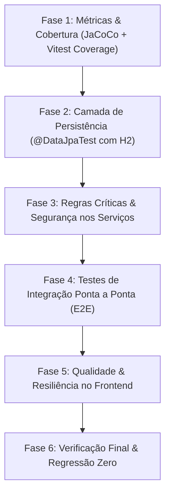

# IP-001: Correção, Robustecimento e Evolução da Suíte de Testes (Backend & Frontend)

- **ID do Plano:** IP-001
- **Status:** Proposto / Pronto para Execução
- **Prioridade:** Alta
- **Componentes Afetados:** `src/test/java/**`, `pom.xml`, `frontend/src/**`, `frontend/package.json`

---

## 1. Contexto e Justificativa

A análise crítica da suíte de testes do projeto **Cola Limpa** revelou que, embora existam 88 testes no backend e 24 no frontend com 100% de aprovação aparente e execução rápida (~10 segundos totais), a confiabilidade real do sistema é vulnerável a falhas silenciosas devido a:
1. **Monocultura de Mocks:** Ausência de testes de persistência (`@DataJpaTest`) e testes de integração ponta a ponta (E2E). Os repositórios e suas queries SQL/JPA nunca foram executados contra um banco de testes.
2. **Pontos Cegos de Segurança:** Ausência de testes para invalidação de OTP após o primeiro uso (*replay attack*), limite de tentativas incorretas (*força bruta*) e checagem de autorização/propriedade (*IDOR*) em operações destrutivas.
3. **Casos de Borda e Concorrência Omitidos:** Falta de testes de concorrência em likes duplicados, limites exatos de estudo contínuo e idempotência em atualização de perfil.
4. **Anti-patterns no Frontend:** Efeito colateral (`onXPGain`) executado dentro de atualizador de estado (`setState`) em `usePomodoro.ts`, não testado sob `StrictMode`, além de componentes testados apenas contra mocks estáticos.
5. **Invisibilidade de Métricas:** Ausência de ferramentas formais de medição de cobertura de código (JaCoCo e Vitest Coverage).

Este plano detalha o roteiro técnico para sanar todas essas vulnerabilidades com base nos princípios de regressão zero, código limpo e integridade arquitetural definidos nas diretrizes do projeto.

---

## 2. Escopo e Objetivos

- **Objetivo 1:** Instituir medição automatizada de cobertura de código no backend (JaCoCo) e frontend (Vitest Coverage).
- **Objetivo 2:** Criar uma camada de testes de repositório reais (`@DataJpaTest`) utilizando H2 configurado em modo PostgreSQL para validar queries customizadas e `@EntityGraph`.
- **Objetivo 3:** Cobrir casos de borda e regras críticas de segurança no backend (invalidação de OTP, bloqueio por tentativas excessivas, idempotência de dados e limites exatos).
- **Objetivo 4:** Criar testes de integração ponta a ponta (E2E) para os principais fluxos de negócio.
- **Objetivo 5:** Refatorar o hook de Pomodoro para eliminar efeitos colaterais impuros em estado, validando com testes em `StrictMode`, e preparar testes de componentes com ciclos assíncronos.

---

## 3. Estratégia de Arquitetura e Fases de Execução

---

### Fase 1: Configuração de Métricas de Cobertura

#### 1.1. Backend: Plugin JaCoCo no Maven
- **Arquivo Alvo:** `pom.xml`
- **Ação:** Configurar `jacoco-maven-plugin` associado às fases `test` e `verify`.
- **Regras:**
  - Configurar exclusões para pacotes de modelo simples, DTOs (records) e configurações puras se necessário.
  - Definir meta de relatório de cobertura em formato HTML e XML em `target/site/jacoco`.
- **Critério de Aceite:**
  - Comando `./mvnw test jacoco:report` gera o relatório com sucesso e sem warnings.

#### 1.2. Frontend: Suporte a Cobertura no Vitest
- **Arquivos Alvo:** `frontend/package.json`, `frontend/vite.config.ts`
- **Ação:** Adicionar `@vitest/coverage-v8` nas `devDependencies` e configurar a seção `coverage` no `vite.config.ts`.
- **Critério de Aceite:**
  - Script `npm --prefix frontend test -- --coverage` gera o sumário de cobertura de linhas e branches.

---

### Fase 2: Camada de Persistência e Repositórios (`@DataJpaTest`)

Criar testes integrados com Spring Data JPA e o banco H2 em memória já existente nas configurações de teste, validando queries, integridade e ausência de problemas N+1 em `@EntityGraph`.

#### 2.1. `UsuarioRepositoryTest`
- **Local:** `src/test/java/com/colalimpa/repository/UsuarioRepositoryTest.java`
- **Cenários a Cobrir:**
  - `shouldPersistAndFindUserByEmail`: Salvar usuário e consultar por e-mail.
  - `shouldPersistAndFindUserByTelefone`: Salvar usuário e consultar por telefone.
  - `shouldReturnTrueWhenEmailExists` e `shouldReturnFalseWhenEmailDoesNotExist`.
  - `shouldThrowExceptionWhenDuplicateEmailIsPersisted`: Garantir que a restrição de unicidade no banco (`unique = true`) seja validada na persistência.

#### 2.2. `PostRepositoryTest`
- **Local:** `src/test/java/com/colalimpa/repository/PostRepositoryTest.java`
- **Cenários a Cobrir:**
  - `shouldFilterPostsWithReportsBelowThreshold`: Validar se posts com 5 denúncias ou mais são efetivamente excluídos da query `findByQtDenunciasLessThanOrderByDataCriacaoDesc(5)`.
  - `shouldFetchPostsWithUserEagerly`: Validar se a consulta carrega a entidade `Usuario` associada sem lazy loading exception (validação do `@EntityGraph`).
  - `shouldFilterPostsByCategoria` e `shouldFilterPostsByMateria`.

#### 2.3. `LikeRepositoryTest`
- **Local:** `src/test/java/com/colalimpa/repository/LikeRepositoryTest.java`
- **Cenários a Cobrir:**
  - `shouldCorrectlyDetectExistingPostLike`: Persistir like para post e checar `existsByUsuarioIdAndPostId`.
  - `shouldCorrectlyDetectExistingCommentLike`: Persistir like para comentário e checar `existsByUsuarioIdAndComentarioId`.
  - `shouldCountLikesForPost` e `shouldCountLikesForComment`.

#### 2.4. `ComentarioRepositoryTest` e `CronometroHistoricoRepositoryTest`
- **Locais:**
  - `src/test/java/com/colalimpa/repository/ComentarioRepositoryTest.java`
  - `src/test/java/com/colalimpa/repository/CronometroHistoricoRepositoryTest.java`
- **Cenários a Cobrir:**
  - Filtro de comentários com limite de denúncias (`findByPostIdAndQtDenunciasLessThanOrderByDataCriacaoAsc`).
  - Carregamento de histórico ordenado por data e intervalo (`findByUsuarioIdAndDataCriacaoBetweenOrderByDataCriacaoAsc`).

---

### Fase 3: Reforço de Regras de Negócio e Segurança nos Serviços

#### 3.1. `AuthServiceTest` e `AuthService`
- **Cenários a Cobrir:**
  - **Invalidação de OTP no Primeiro Uso (Prevenção de Replay Attack):**
    - Após validar o código com sucesso, uma segunda chamada com o mesmo código deve lançar `BusinessRuleException` ("Código de autenticação expirado ou já utilizado").
  - **Bloqueio por Limite de Tentativas Incorretas:**
    - Ao errar o código 3 vezes sucessivas, o código deve ser marcado como bloqueado/inválido.
  - **Limites Exatos de Tempo de Reenvio:**
    - Testar a borda exata dos 30 segundos (29s rejeita, 30s/31s permite).
- **Critério de Aceite:**
  - Nenhuma brecha de repetição de OTP ou tentativas infinitas permitida nos testes.

#### 3.2. `CronometroServiceTest`
- **Cenários a Cobrir:**
  - **Corte de Bônus Pomodoro Incompleto:**
    - Registrar sessão com 1499 segundos no modo `POMODORO` e verificar se concede XP proporcional de tempo, mas **zero de bônus** (bônus de 25 XP exclusivo para `>= 1500s`).
  - **Limite Biológico Exato:**
    - Registrar sessão com exatamente 57600 segundos (16 horas permitidas) com sucesso, e 57601 segundos gerando erro.
  - **Proteção contra Tempos Negativos ou Nulos:**
    - Rejeição de valores `<= 0` diretamente no serviço.

#### 3.3. `UsuarioServiceTest`
- **Cenários a Cobrir:**
  - **Idempotência de Perfil:**
    - Atualizar perfil mantendo o mesmo e-mail e telefone do próprio usuário sem disparar falso positivo de "e-mail/telefone já em uso".
  - **Proteção contra Pontuação Negativa:**
    - Testar comportamento de `adicionarXp` com valores negativos.

---

### Fase 4: Testes de Integração Ponta a Ponta (E2E)

- **Local:** `src/test/java/com/colalimpa/integration/ColaLimpaE2ETest.java`
- **Anotações:** `@SpringBootTest(webEnvironment = SpringBootTest.WebEnvironment.RANDOM_PORT)`, `@AutoConfigureMockMvc`
- **Cenários a Cobrir:**
  1. **Fluxo Completo de Autenticação:**
     - Solicitar OTP -> Obter código persistido -> Validar OTP -> Obter Token -> Validar que reuso do OTP falha.
  2. **Ciclo de Vida do Post e Curtida:**
     - Criar usuário -> Criar post -> Curtir post -> Verificar contador incrementado -> Descurtir post -> Verificar decremento.
  3. **Tratamento Global de Erros em Nível HTTP:**
     - Envio de JSON malformado (`HttpMessageNotReadableException`) -> Retorno padronizado de `ProblemDetail` com status 400.
     - Acesso a ID inexistente -> Retorno 404 padronizado.

---

### Fase 5: Qualidade e Resiliência no Frontend

#### 5.1. Refatoração e Testes de `usePomodoro`
- **Ação:**
  - Extrair o efeito colateral `onXPGain` de dentro do updater de `setState` em `usePomodoro.ts` para um `useEffect` disparado na transição de término.
  - No arquivo de testes `usePomodoro.test.ts`, adicionar teste garantindo que o hook não duplica chamadas quando executado sob `<React.StrictMode>`.
- **Critério de Aceite:**
  - Passa 100% dos testes sem avisos de funções impuras e sem duplicar eventos.

#### 5.2. Testes de Estados Assíncronos e Acessibilidade
- **Componentes:** `PomodoroTimer.test.tsx`, `CommunityFeed.test.tsx`
- **Cenários a Cobrir:**
  - Validar atributos de acessibilidade (`aria-label`, foco em botões interativos e tags semânticas).
  - Testar navegação por teclado nos filtros de categorias.
  - Testar estados de lista vazia no feed.

---

## 4. Matriz de Riscos e Mitigações

| Risco | Impacto | Mitigação |
| :--- | :--- | :--- |
| **Divergência SQL H2 vs PostgreSQL** | Médio | Manter configuração `MODE=PostgreSQL` no H2 e testar apenas sintaxe compatível com JPA padrão. |
| **Tempo de Execução da Suíte** | Baixo | `@DataJpaTest` carrega apenas a fatia JPA, mantendo a suíte de persistência abaixo de 3 segundos. |
| **Quebra de Testes Existentes (Regressão)** | Alto | Executar `./mvnw test` e `npm test` a cada fase concluída antes de avançar para a próxima. |
| **Violação de Regras de Clean Code** | Alto | Proibição rigorosa de comentários descritivos nos novos testes; nomes semânticos autodocumentados. |

---

## 5. Critérios de Aceite Globais (Definition of Done)

1. **Compilação e Linter Limpos:**
   - `./mvnw test-compile` e `./mvnw compile` sem warnings.
   - `npm --prefix frontend run lint` e `npm --prefix frontend run build` sem erros ou warnings.
2. **Cobertura Automatizada Ativa:**
   - JaCoCo configurado no backend com geração de relatório em `target/site/jacoco`.
   - Vitest Coverage configurado no frontend.
3. **Persistência Relacional Testada:**
   - Mínimo de 10 novos testes de repositório cobrindo queries customizadas e `@EntityGraph`.
4. **Segurança Validade:**
   - Replay attack de OTP coberto e bloqueado por teste automatizado.
   - Tentativas consecutivas de erro com OTP bloqueadas por teste automatizado.
5. **Regressão Zero:**
   - Os 88 testes de backend e 24 testes de frontend originais continuam passando integralmente.
