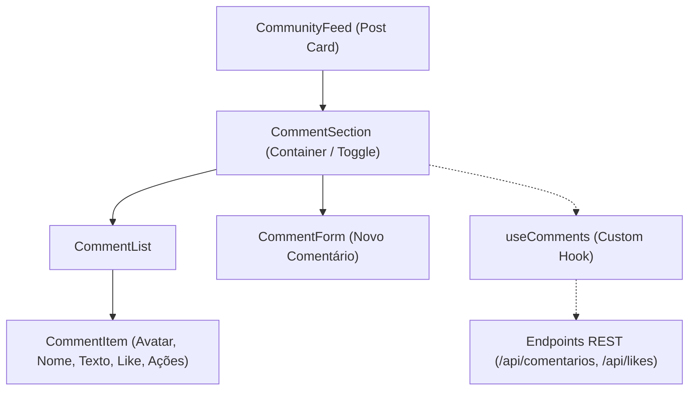

# IP-002: Implementação da Seção de Comentários Interativa (Frontend & Integração)

- **ID do Plano:** IP-002
- **Status:** Proposto / Pronto para Execução
- **Prioridade:** Alta
- **Componentes Afetados:** `frontend/src/components/**`, `frontend/src/hooks/**`, `frontend/src/App.css`, `frontend/src/types/**`, `src/main/java/**` (refinamento DTO)

---

## 1. Contexto e Justificativa

Atualmente, o backend do **Cola Limpa** possui uma estrutura completa para comentários (`ComentarioController`, `ComentarioService`, `ComentarioRepository` e entidade `Comentario`), incluindo criação, listagem por post, denúncias e remoção. No entanto, no frontend (`CommunityFeed.tsx`), o botão de comentários (`<MessageCircle />`) é puramente ilustrativo e não realiza nenhuma ação.

Este plano de implementação define a arquitetura, componentes, hooks e testes necessários para introduzir uma **seção de comentários rica, responsiva e interativa** em cada publicação do feed, respeitando todas as diretrizes de Clean Code, acessibilidade, separação de responsabilidades (SRP) e tolerância zero a warnings.

---

## 2. Objetivos e Critérios de Sucesso

1. **Interatividade Completa:** Permitir ao usuário expandir/colapsar os comentários de um post, ler a lista de comentários em ordem cronológica e postar novos comentários instantaneamente.
2. **Engajamento e Moderação:** Permitir curtir comentários (integrado com o sistema de likes), denunciar comentários ofensivos e remover comentários próprios.
3. **Separação Estrita de Responsabilidades:** Toda a lógica de estado, mutação e efeitos assíncronos deve residir em um Custom Hook dedicado (`useComments`), mantendo os componentes de interface puramente apresentacionais.
4. **Acessibilidade e Design Mobile-First:** Uso de tags semânticas (`<section>`, `<form>`, `<button>`), suporte completo a atributos ARIA (`aria-expanded`, `aria-label`), contraste e layout fluido sem overflow horizontal.
5. **Qualidade e Cobertura:** 100% dos novos componentes e hooks acompanhados de testes automatizados determinísticos no Vitest / React Testing Library, mantendo regressão zero na suíte existente.

---

## 3. Arquitetura da Solução



### 3.1. Estrutura de Tipos e DTOs

Definição estrita no frontend (`frontend/src/types/comment.ts`):
```typescript
export interface Comment {
  id: number;
  postId: number;
  authorId: number;
  authorName: string;
  authorAvatar: string;
  content: string;
  likes: number;
  liked: boolean;
  reports: number;
  createdAt: string;
}

export interface NewCommentPayload {
  postId: number;
  authorId: number;
  content: string;
}
```

---

## 4. Fases Detalhadas de Execução

### Fase 1: Backend DTO & Validação de Entrada
- **Objetivo:** Garantir integridade e segurança de dados nos comentários recebidos.
- **Arquivos Alvo:**
  - `src/main/java/com/colalimpa/dto/ComentarioRequest.java`
- **Ações:**
  - Adicionar anotação de tamanho `@Size(min = 1, max = 1000)` para impedir comentários excessivamente longos ou vazios no payload.
  - Verificar compatibilidade de serialização de `ComentarioResponse`.
- **Critério de Aceite:**
  - Testes de validação em `ComentarioControllerTest` continuam passando e rejeitam comentários com texto excedendo 1000 caracteres.

---

### Fase 2: Custom Hook `useComments`
- **Objetivo:** Centralizar a lógica de negócio, mutações e estados de comentários desacoplados da interface.
- **Arquivo Alvo:** `frontend/src/hooks/useComments.ts`
- **Responsabilidades do Hook:**
  - Estado da lista de comentários (`comments: Comment[]`).
  - Estado de carregamento (`isLoading: boolean`) e envio (`isSubmitting: boolean`).
  - Estado de visibilidade (`isOpen: boolean`) e alternância (`toggleOpen()`).
  - Métodos de ação:
    - `addComment(content: string): Promise<void>`
    - `toggleLikeComment(commentId: number): void`
    - `reportComment(commentId: number): void`
    - `deleteComment(commentId: number): void`
- **Arquivo de Teste:** `frontend/src/hooks/useComments.test.ts`
  - Testa inicialização, alternância de visibilidade, adição de comentário, toggle de like e remoção.

---

### Fase 3: Componentes Visuais de Comentários
- **Objetivo:** Criar componentes limpos, coesos e acessíveis.
- **Arquivos a Criar:**
  1. `frontend/src/components/CommentItem.tsx`:
     - Renderiza avatar em formato circular, nome do autor e data formatada ("Há 5 min").
     - Exibe texto sanitizado do comentário.
     - Botão interativo de curtir comentário com coração preenchido quando ativo.
     - Botão de denúncia discreto.
  2. `frontend/src/components/CommentForm.tsx`:
     - Campo `<textarea>` ou `<input>` com auto-expand.
     - Contador de caracteres em tempo real (ex: `120/1000`).
     - Botão de envio com ícone `<Send size={16} />`, desabilitado quando o campo estiver vazio ou em submissão.
     - Acessibilidade: atalho `Ctrl+Enter` / `Cmd+Enter` para submeter comentário rapidamente.
  3. `frontend/src/components/CommentSection.tsx`:
     - Container articulado com animação suave de acordeão (`slideDown`).
     - Exibe cabeçalho com total de comentários.
     - Renderiza `CommentForm` no topo ou base.
     - Renderiza `CommentItem` para cada item ou mensagem amigável quando vazio (*"Nenhum comentário ainda. Seja o primeiro a participar!"*).

---

### Fase 4: Integração com `CommunityFeed` e Estilização
- **Arquivos Alvo:**
  - `frontend/src/components/CommunityFeed.tsx`
  - `frontend/src/App.css`
- **Ações:**
  - No `CommunityFeed`, ligar o botão `<button className="post-action-btn">` com a abertura do acordeão `CommentSection` para o post correspondente.
  - Atualizar o contador dinâmico de comentários no rodapé do post card ao adicionar/remover comentários.
  - Estilizar a seção de comentários em harmonia com a paleta existente (tons quentes, bordas suaves, tipografia consistente com Nunito, espaçamentos semânticos).

---

### Fase 5: Suíte de Testes Automatizados no Frontend
- **Arquivos de Teste a Criar/Atualizar:**
  - `frontend/src/components/CommentSection.test.tsx`
  - `frontend/src/components/CommentForm.test.tsx`
  - `frontend/src/components/CommunityFeed.test.tsx` (atualização para testar clique no botão de comentários)
- **Cenários a Cobrir:**
  - Expansão da seção ao clicar no botão de comentários do post.
  - Validação de formulário: botão de envio desabilitado com campo vazio.
  - Submissão de novo comentário e incremento imediato no contador do post.
  - Alternância de curtida no comentário específico.
  - Remoção de comentário e atualização da lista.

---

## 5. Matriz de Riscos e Mitigações

| Risco | Impacto | Mitigação |
| :--- | :--- | :--- |
| **Re-renders excessivos no Feed** | Médio | Cada `post-card` gerencia sua própria instância de `useComments` ou recebe estado isolado, evitando que a digitação em um post re-renderize os outros. |
| **Quebra de layout em telas mobile** | Alto | Utilizar flexbox com `flex-wrap`, campos de formulário fluidos (`width: 100%`) e botões com área de toque mínima de 44px. |
| **XSS / Injeção via comentário** | Crítico | React escapa strings por padrão no JSX. Proibição absoluta de `dangerouslySetInnerHTML`. Validação de tamanho no backend. |

---

## 6. Critérios de Aceite (Definition of Done)

1. Botão de comentários no `CommunityFeed` abre e fecha a seção de comentários com animação fluida.
2. Usuário consegue digitar, enviar comentário e vê-lo refletido instantaneamente na lista e no contador.
3. Botão de curtir comentário altera estado e atualiza contador de forma reativa.
4. `npm run lint` executa sem nenhum erro ou aviso (`oxlint`).
5. `npm run test:coverage` passa 100% com nova suíte de testes cobrindo hook e componentes de comentários.
6. Suíte de testes do backend (`./mvnw test`) permanece 100% íntegra.

