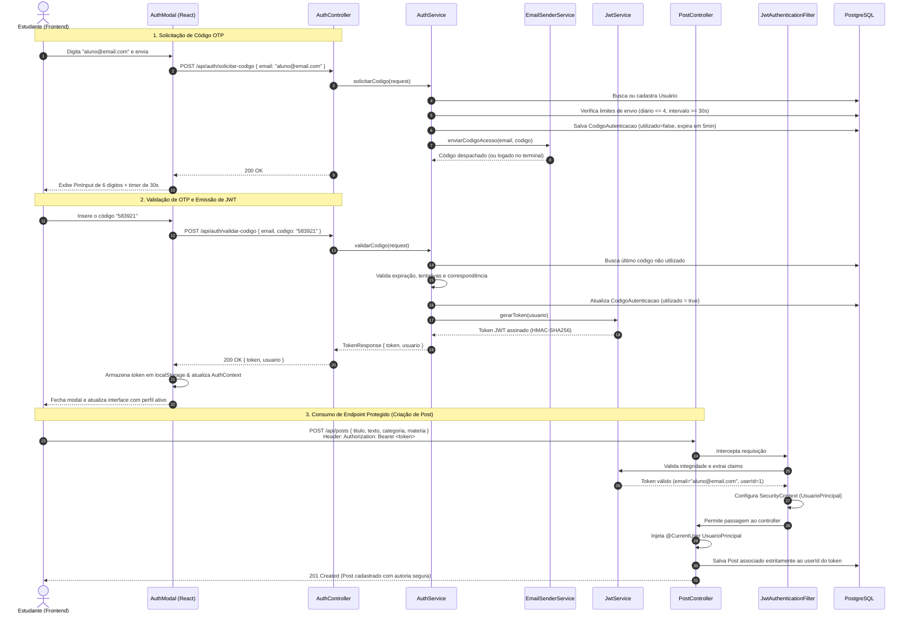
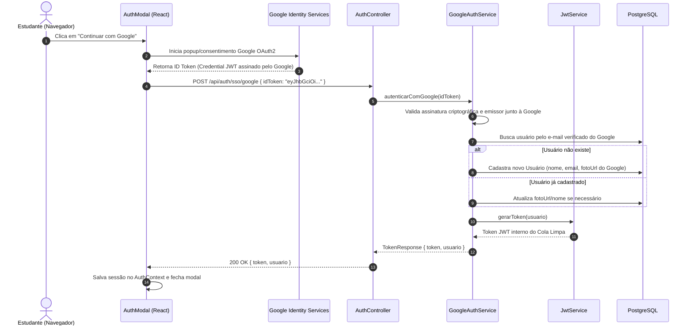
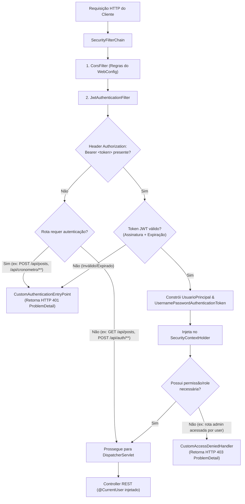

# IP-003: Implementação Completa do Sistema de Autenticação e Login (Passwordless OTP & JWT)

- **ID do Plano:** IP-003
- **Status:** Proposto / Pronto para Execução
- **Prioridade:** Crítica
- **Componentes Afetados:** 
  - Backend: `pom.xml`, `src/main/java/com/colalimpa/security/**`, `src/main/java/com/colalimpa/service/**`, `src/main/java/com/colalimpa/controller/**`, `src/main/java/com/colalimpa/dto/**`, `src/main/java/com/colalimpa/model/**`, `src/main/resources/application.properties`, `src/test/java/**`
  - Frontend: `frontend/src/types/**`, `frontend/src/services/**`, `frontend/src/context/**`, `frontend/src/components/**`, `frontend/src/hooks/**`, `frontend/src/App.tsx`, `frontend/src/App.css`

---

## 1. Contexto, Diagnóstico do Código e Motivação

O projeto **Cola Limpa** foi concebido como uma plataforma colaborativa voltada para estudantes e vestibulandos. Os documentos técnicos fundamentais ([Requisitos.md](file:///home/joao/IdeaProjects/Cola-Limpa-backend/docs/uml/Requisitos.md), [Diagrama_de_Classes.md](file:///home/joao/IdeaProjects/Cola-Limpa-backend/docs/uml/Diagrama_de_Classes.md), [Diagrama_de_Sequencia.md](file:///home/joao/IdeaProjects/Cola-Limpa-backend/docs/uml/Diagrama_de_Sequencia.md) e [TCC_Cola_Limpa.md](file:///home/joao/IdeaProjects/Cola-Limpa-backend/docs/etec/TCC_Cola_Limpa.md)) especificam uma **arquitetura de segurança sem senhas (Passwordless)** baseada no envio de códigos numéricos de uso único (OTP) ao e-mail cadastrado, autenticação federada opcional via **Single Sign-On (SSO Google)**, e gerenciamento de sessões estritamente **stateless via tokens criptográficos JWT (JSON Web Token)**.

Além disso, a especificação determina a existência de três perfis de acesso bem delimitados:
1. **Visitante (Guest):** Acesso de leitura ao feed público e comentários; restrito de realizar postagens, curtir, comentar ou persistir histórico de cronômetro.
2. **Usuário Comum (Autenticado):** Acesso pleno a interações sociais, registro de sessões de Pomodoro, ganho de experiência (XP) e edição de perfil.
3. **Administrador:** Permissões estendidas para moderação de publicações e comentários denunciados pela comunidade.

### Auditoria Detalhada do Código Atual (Gaps Identificados)

A inspeção do repositório revelou um abismo entre as especificações arquiteturais e o estado atual da base de código:

1. **Inexistência do Spring Security no Backend:**
   - O arquivo [`pom.xml`](file:///home/joao/IdeaProjects/Cola-Limpa-backend/pom.xml) não inclui o starter `spring-boot-starter-security`. Consequentemente, **todos os endpoints da aplicação estão 100% abertos e desprotegidos na rede**. Qualquer requisição HTTP atinge os controllers sem qualquer camada de autenticação ou autorização.
2. **Token Fictício e Sem Criptografia em `AuthService`:**
   - Em [`AuthService.java`](file:///home/joao/IdeaProjects/Cola-Limpa-backend/src/main/java/com/colalimpa/service/AuthService.java#L91), o método `validarCodigo` gera um identificador arbitrário `UUID.randomUUID().toString()`. Não existe assinatura digital, claims de autorização, expiração criptográfica nem conformidade com o padrão RFC 7519 (JWT).
3. **Vulnerabilidade Crítica de IDOR (Insecure Direct Object Reference):**
   - Os DTOs de mutação de dados — [`PostRequest`](file:///home/joao/IdeaProjects/Cola-Limpa-backend/src/main/java/com/colalimpa/dto/PostRequest.java), [`ComentarioRequest`](file:///home/joao/IdeaProjects/Cola-Limpa-backend/src/main/java/com/colalimpa/dto/ComentarioRequest.java), [`LikeRequest`](file:///home/joao/IdeaProjects/Cola-Limpa-backend/src/main/java/com/colalimpa/dto/LikeRequest.java) e [`CronometroHistoricoRequest`](file:///home/joao/IdeaProjects/Cola-Limpa-backend/src/main/java/com/colalimpa/dto/CronometroHistoricoRequest.java) — exigem que o cliente envie o campo `@NotNull Long usuarioId` no corpo do payload JSON.
   - Qualquer ator malicioso pode alterar o valor de `usuarioId` para forjar postagens, comentários ou curtidas em nome de outro usuário sem qualquer verificação de propriedade no servidor.
4. **Vulnerabilidade a Replay Attack em Códigos OTP:**
   - A entidade [`CodigoAutenticacao`](file:///home/joao/IdeaProjects/Cola-Limpa-backend/src/main/java/com/colalimpa/model/CodigoAutenticacao.java) armazena o código de 6 dígitos e a data de expiração, mas **não possui flag ou registro de utilização**. Uma vez gerado, o mesmo código pode ser validado repetidamente até que expire a janela de 5 minutos, permitindo reutilização indevida.
5. **Envio de Códigos OTP Ausente (Sem Abstração de Mensageria):**
   - O código numérico é salvo na base de dados, mas não existe nenhuma interface para despacho ao usuário. Falta uma abstração que opere em modo simulado/log para desenvolvimento e que permita plugar facilmente um provedor SMTP/JavaMailSender em produção.
6. **Frontend Totalmente Desprovido de Autenticação:**
   - A aplicação React (`frontend/src`) não possui tela ou modal de login, formulários de entrada de OTP, controle de sessão (`AuthContext`), persistência de token (`localStorage`) ou cliente HTTP para injetar o header `Authorization: Bearer <token>`.
7. **Ausência de Barreiras para Visitantes no Frontend:**
   - O feed e o cronômetro não diferenciam visitantes de usuários logados, falhando em solicitar autenticação quando um visitante tenta curtir, comentar ou postar.

---

## 2. Padrões de Engenharia e Princípios Arquiteturais

Para sanar essas vulnerabilidades e entregar uma solução robusta e escalável, a implementação seguirá os seguintes pilares de engenharia:

### 2.1. Princípios SOLID e Clean Architecture
- **Single Responsibility Principle (SRP):**
  - `JwtService`: Responsabilidade exclusiva de emitir, assinar e verificar tokens JWT.
  - `AuthService`: Orquestração de regras de negócio de autenticação (limites, geração de OTP, validação).
  - `EmailSenderService`: Abstração para despacho de mensagens e templates.
  - `JwtAuthenticationFilter`: Interceptação e conversão de credenciais HTTP em `Authentication` do Spring Security.
- **Open-Closed Principle (OCP):**
  - A interface `EmailSenderService` permite plugar implementações de log (`ConsoleEmailSenderService`), envio SMTP (`SmtpEmailSenderService`) ou serviços de terceiros (SendGrid, AWS SES) sem alterar o core de `AuthService`.
- **Dependency Inversion Principle (DIP):**
  - Controllers e services dependem de abstrações de segurança e mensageria, desacoplados de bibliotecas externas específicas.

### 2.2. Diretrizes de Segurança (OWASP Top 10 e NIST 800-63B)
- **Eliminação Absoluta de IDOR:**
  - O `usuarioId` é **removido dos DTOs de criação de conteúdo**. A identidade do autor é resolvida exclusivamente a partir do token JWT verificado no servidor, injetado no controller via meta-anotação customizada `@CurrentUser UsuarioPrincipal`.
- **Prevenção contra Força Bruta em OTP (NIST 800-63B §5.1.4):**
  - Travamento automático após 3 tentativas incorretas consecutivas.
  - Intervalo anti-spam mínimo de 30 segundos entre pedidos de novo código.
  - Teto diário de no máximo 4 solicitações de código por endereço de e-mail a cada 24 horas.
  - Expiração rígida de 5 minutos por código.
- **Prevenção contra Replay Attack:**
  - O código OTP é marcado como `utilizado = true` dentro da mesma transação de banco de dados (`@Transactional`) no instante em que é validado com sucesso. Códigos marcados como utilizados são imediatamente rejeitados.
- **Sessões 100% Stateless e Criptografia Forte:**
  - Assinatura digital via **HMAC-SHA256** utilizando segredo de alta entropia (mínimo de 256 bits).
  - Ausência total de estado de sessão (`SessionCreationPolicy.STATELESS`) e cookies de sessão (`JSESSIONID`), eliminando riscos de CSRF em navegadores modernos.
- **Padronização de Erros REST (RFC 7807):**
  - Falhas de autenticação (HTTP 401) e autorização (HTTP 403) retornam estritamente o formato `ProblemDetail`, perfeitamente integrado ao `GlobalExceptionHandler` já existente.

---

## 3. Arquitetura da Solução & Diagramas Detalhados

### 3.1. Diagrama de Sequência — Ciclo Completo Passwordless OTP & Acesso a Recurso Protegido



---

### 3.2. Diagrama de Sequência — Single Sign-On (Google SSO via ID Token)



---

### 3.3. Diagrama da Cadeia de Filtros de Segurança do Spring Security 6



---

### 3.4. Especificação de Claims do Token JWT do Cola Limpa

O token gerado pelo Cola Limpa conterá o cabeçalho padrão `{ "alg": "HS256", "typ": "JWT" }` e o payload estruturado a seguir:

| Claim | Tipo | Exemplo | Finalidade |
| :--- | :--- | :--- | :--- |
| `sub` | `String` | `"estudante@email.com"` | Assunto padrão (e-mail do estudante) |
| `userId` | `Long` | `1` | Identificador único primário do usuário |
| `nome` | `String` | `"João Victor"` | Nome exibido na interface do usuário |
| `roles` | `List<String>` | `["ROLE_USER"]` ou `["ROLE_ADMIN"]` | Autorizações para `@PreAuthorize` |
| `isAdmin` | `Boolean` | `false` | Flag booleana de moderação e privilégios |
| `iat` | `Long` | `1730198400` | Timestamp de emissão (Issued At) |
| `exp` | `Long` | `1730284800` | Timestamp de expiração (24 horas após `iat`) |

---

## 4. Estrutura de Banco de Dados e Refatoração de Entidade

### 4.1. Refatoração da Tabela `codigo_autenticacao`
Para garantir a prevenção de **Replay Attacks**, a tabela `codigo_autenticacao` deve armazenar o estado de consumo do código:

```sql
-- Adição da coluna 'utilizado' caso não exista
ALTER TABLE codigo_autenticacao 
ADD COLUMN IF NOT EXISTS utilizado BOOLEAN NOT NULL DEFAULT FALSE;

-- Criação de índice para otimização de busca de códigos ativos
CREATE INDEX IF NOT EXISTS idx_codigo_usuario_ativo 
ON codigo_autenticacao (usuario_id, data_criacao DESC);
```

### 4.2. Atualização da Entidade `CodigoAutenticacao.java`
- Adicionar o atributo:
  ```java
  @Column(nullable = false)
  private Boolean utilizado = false;
  ```
- Adicionar os métodos utilitários de negócio:
  ```java
  public boolean isUtilizado() {
      return Boolean.TRUE.equals(this.utilizado);
  }

  public void marcarComoUtilizado() {
      this.utilizado = true;
  }

  public boolean isValido() {
      return !isExpirado() && !isUtilizado() && (tentativasEnvio == null || tentativasEnvio < 3);
  }
  ```

---

## 5. Fases Detalhadas de Execução Passo a Passo

```mermaid
flowchart LR
    F1["Fase 1: Infraestrutura Spring Security & JWT"] --> F2["Fase 2: Mensageria OTP & Blindagem do AuthService"]
    F2 --> F3["Fase 3: Erradicação de IDOR & Proteção de Endpoints"]
    F3 --> F4["Fase 4: Integração Google SSO (Backend)"]
    F4 --> F5["Fase 5: Frontend - AuthContext & Cliente HTTP"]
    F5 --> F6["Fase 6: Frontend - Componentes (PinInput, Modal, UserMenu)"]
    F6 --> F7["Fase 7: Frontend - Guards de Ação do Visitante"]
    F7 --> F8["Fase 8: Suíte de Testes Automatizados (Zero Regressão)"]
```



---

### Fase 1: Infraestrutura de Segurança Backend (Spring Security 6 & JJWT)

#### 1.1. Manifesto de Dependências (`pom.xml`)
- Adicionar os starters e bibliotecas com versões gerenciadas:
  ```xml
  <!-- Spring Security Starter -->
  <dependency>
      <groupId>org.springframework.boot</groupId>
      <artifactId>spring-boot-starter-security</artifactId>
  </dependency>

  <!-- JJWT 0.12.6 Oficial -->
  <dependency>
      <groupId>io.jsonwebtoken</groupId>
      <artifactId>jjwt-api</artifactId>
      <version>0.12.6</version>
  </dependency>
  <dependency>
      <groupId>io.jsonwebtoken</groupId>
      <artifactId>jjwt-impl</artifactId>
      <version>0.12.6</version>
      <scope>runtime</scope>
  </dependency>
  <dependency>
      <groupId>io.jsonwebtoken</groupId>
      <artifactId>jjwt-jackson</artifactId>
      <version>0.12.6</version>
      <scope>runtime</scope>
  </dependency>

  <!-- Google API Client para validação segura de ID Token no SSO -->
  <dependency>
      <groupId>com.google.api-client</groupId>
      <artifactId>google-api-client</artifactId>
      <version>2.6.0</version>
  </dependency>

  <!-- Spring Security Test Support -->
  <dependency>
      <groupId>org.springframework.security</groupId>
      <artifactId>spring-security-test</artifactId>
      <scope>test</scope>
  </dependency>
  ```

#### 1.2. Parâmetros em `application.properties`
- Configurar parâmetros externos com fallbacks seguros para testes:
  ```properties
  # Segurança e JWT
  jwt.secret=${JWT_SECRET:colalimpa-super-secret-key-that-has-at-least-256-bits-length-security!}
  jwt.expiration-ms=${JWT_EXPIRATION_MS:86400000}

  # Configuração de Mensageria OTP
  colalimpa.mail.smtp.enabled=${SMTP_ENABLED:false}
  ```

#### 1.3. Implementação do `JwtService`
- **Arquivo:** `src/main/java/com/colalimpa/security/JwtService.java`
- **Métodos essenciais:**
  - `String gerarToken(Usuario usuario)`: Gera token assinado com claims `userId`, `nome`, `isAdmin`, roles e expiração.
  - `String extrairEmail(String token)`: Lê o claim `sub`.
  - `Long extrairUsuarioId(String token)`: Lê o claim `userId`.
  - `boolean isTokenValido(String token, UserDetails userDetails)`: Valida correspondência de usuário e não-expiração.
  - `SecretKey getSigningKey()`: Inicializa chave HMAC a partir da string codificada/configurada.

#### 1.4. Modelo de Principal: `UsuarioPrincipal`
- **Arquivo:** `src/main/java/com/colalimpa/security/UsuarioPrincipal.java`
- **Contrato:** Implementa `UserDetails`.
- **Atributos:** `Long id`, `String email`, `String nome`, `Boolean isAdmin`, `Collection<? extends GrantedAuthority> authorities`.
- Mapeia `isAdmin = true` para as authorities `ROLE_ADMIN` e `ROLE_USER`; caso contrário, apenas `ROLE_USER`.

#### 1.5. Serviço de Resolução de Usuário: `CustomUserDetailsService`
- **Arquivo:** `src/main/java/com/colalimpa/security/CustomUserDetailsService.java`
- **Responsabilidade:** Implementa `UserDetailsService`, realizando busca eficiente por e-mail em `UsuarioRepository` e retornando uma instância de `UsuarioPrincipal`.

#### 1.6. Filtro de Autenticação: `JwtAuthenticationFilter`
- **Arquivo:** `src/main/java/com/colalimpa/security/JwtAuthenticationFilter.java`
- **Padrão:** Herda de `OncePerRequestFilter`.
- **Lógica de Execução:**
  1. Extrai cabeçalho `Authorization`. Se ausente ou não iniciar com `Bearer `, delega imediatamente para o próximo filtro na cadeia (`filterChain.doFilter`).
  2. Extrai e valida o token via `JwtService`.
  3. Se válido e não houver autenticação presente no `SecurityContextHolder`:
     - Carrega `UsuarioPrincipal` via `CustomUserDetailsService`.
     - Instancia `UsernamePasswordAuthenticationToken` e associa detalhes da requisição (`WebAuthenticationDetailsSource`).
     - Aloca no `SecurityContextHolder.getContext().setAuthentication(auth)`.
  4. Caso o token esteja expirado ou com assinatura corrompida, **não lança exceção não-tratada no filtro**; permite que o fluxo alcance o `SecurityFilterChain`, disparando o `AuthenticationEntryPoint` padronizado.

#### 1.7. Tratamento Centralizado de 401 e 403 via `ProblemDetail` (RFC 7807)
- **Arquivos:**
  - `src/main/java/com/colalimpa/security/CustomAuthenticationEntryPoint.java`
  - `src/main/java/com/colalimpa/security/CustomAccessDeniedHandler.java`
- **Regra de Excelência:** Injetar o `HandlerExceptionResolver` do Spring Boot para delegar a serialização da resposta de erro ao `GlobalExceptionHandler`, garantindo que respostas 401 e 403 possuam a mesma estrutura e campos que qualquer outra exceção da aplicação.

#### 1.8. Configuração Central: `SecurityConfig`
- **Arquivo:** `src/main/java/com/colalimpa/security/SecurityConfig.java`
- **Anotações:** `@Configuration`, `@EnableWebSecurity`, `@EnableMethodSecurity(prePostEnabled = true)`.
- **Regras da Cadeia de Filtros (`SecurityFilterChain`):**
  - Desativar CSRF (`csrf.disable()`) por ser API REST stateless.
  - Integrar com o `CorsFilter` configurado no `WebConfig`.
  - Definir gerenciamento de sessão estritamente stateless (`SessionCreationPolicy.STATELESS`).
  - Associar `CustomAuthenticationEntryPoint` e `CustomAccessDeniedHandler`.
  - **Mapeamento de Rotas (`authorizeHttpRequests`):**
    - `POST /api/auth/**`: Acesso público total (`permitAll()`).
    - `GET /api/posts/**`: Acesso público total para leitura no feed (`permitAll()`).
    - `GET /api/comentarios/**`: Acesso público total para leitura de comentários (`permitAll()`).
    - `POST /api/posts`: Autenticado (`authenticated()`).
    - `PUT /api/posts/**`, `DELETE /api/posts/**`: Autenticado (`authenticated()`).
    - `POST /api/comentarios`, `DELETE /api/comentarios/**`: Autenticado (`authenticated()`).
    - `POST /api/likes/**`, `DELETE /api/likes/**`: Autenticado (`authenticated()`).
    - `/api/cronometro/**`: Autenticado (`authenticated()`).
    - `/api/usuarios/perfil`: Autenticado (`authenticated()`).
    - Qualquer outro endpoint: Autenticado (`authenticated()`).
  - Adicionar `JwtAuthenticationFilter` antes de `UsernamePasswordAuthenticationFilter`.

#### 1.9. Meta-Anotação Customizada `@CurrentUser`
- **Arquivo:** `src/main/java/com/colalimpa/security/CurrentUser.java`
  ```java
  package com.colalimpa.security;

  import java.lang.annotation.ElementType;
  import java.lang.annotation.Retention;
  import java.lang.annotation.RetentionPolicy;
  import java.lang.annotation.Target;
  import org.springframework.security.core.annotation.AuthenticationPrincipal;

  @Target({ElementType.PARAMETER, ElementType.TYPE})
  @Retention(RetentionPolicy.RUNTIME)
  @AuthenticationPrincipal
  public @interface CurrentUser {
  }
  ```

---

### Fase 2: Mensageria de OTP e Blindagem de Negócio (`AuthService`)

#### 2.1. Abstração de Envio de E-mails: `EmailSenderService`
- **Arquivo:** `src/main/java/com/colalimpa/service/EmailSenderService.java`
  ```java
  package com.colalimpa.service;

  public interface EmailSenderService {
      void enviarCodigoAcesso(String emailDestinatario, String codigo);
  }
  ```

#### 2.2. Implementação de Desenvolvimento/Testes: `ConsoleEmailSenderService`
- **Arquivo:** `src/main/java/com/colalimpa/service/impl/ConsoleEmailSenderService.java`
- **Anotações:** `@Service`, `@ConditionalOnProperty(name = "colalimpa.mail.smtp.enabled", havingValue = "false", matchIfMissing = true)`.
- **Comportamento:** Imprime um banner visual no console estruturado com o código formatado em destaque, permitindo aos desenvolvedores e testadores obterem o código instantaneamente sem necessidade de servidor SMTP real.

#### 2.3. Implementação de Produção: `SmtpEmailSenderService`
- **Arquivo:** `src/main/java/com/colalimpa/service/impl/SmtpEmailSenderService.java`
- **Anotações:** `@Service`, `@ConditionalOnProperty(name = "colalimpa.mail.smtp.enabled", havingValue = "true")`.
- **Comportamento:** Formata e despacha um e-mail HTML com identidade visual do Cola Limpa utilizando `JavaMailSender`.

#### 2.4. Refatoração e Blindagem de `AuthService.java`
- **Injeção de Dependências:** `UsuarioRepository`, `CodigoAutenticacaoRepository`, `EmailSenderService`, `JwtService`.
- **Refatoração do método `solicitarCodigo`:**
  1. Busca ou instancia novo usuário com perfil inicial.
  2. Valida se o usuário não atingiu o limite de 4 envios nas últimas 24h.
  3. Valida se o usuário não solicitou envio há menos de 30 segundos.
  4. Gera código numérico seguro de 6 dígitos via `SecureRandom` (`String.format("%06d", secureRandom.nextInt(1_000_000))`).
  5. Salva entidade `CodigoAutenticacao` com `expiracao = now() + 5 min` e `utilizado = false`.
  6. Dispara `emailSenderService.enviarCodigoAcesso(usuario.getEmail(), codigoGerado)`.
- **Refatoração do método `validarCodigo`:**
  1. Busca usuário por e-mail; se não existir, lança `ResourceNotFoundException`.
  2. Consulta o último código gerado para o usuário.
  3. Checa se o código já foi consumido (`codigo.isUtilizado()`): se sim, lança `BusinessRuleException("Código de autenticação expirado ou já utilizado.")`.
  4. Checa se o código está expirado (`codigo.isExpirado()`): se sim, lança `BusinessRuleException("O código informado expirou. Solicite um novo código.")`.
  5. Checa se o código foi bloqueado por tentativas excessivas (`tentativas >= 3`): se sim, lança `BusinessRuleException("Código bloqueado por excesso de tentativas incorretas.")`.
  6. Compara os dígitos informados com o código salvo:
     - Se divergente: incrementa `tentativasEnvio`, salva e lança `BusinessRuleException("Código de autenticação inválido.")`.
     - Se coincidente: **marca imediatamente `codigo.marcarComoUtilizado()`**, persiste a atualização, invoca `jwtService.gerarToken(usuario)` e retorna `new TokenResponse(tokenJwt, UsuarioResponse.fromEntity(usuario))`.

---

### Fase 3: Erradicação Radical de IDOR e Injeção de Identidade nos Controladores

#### 3.1. Reestruturação dos DTOs de Criação de Recursos
Para eliminar a possibilidade de um usuário enviar dados forjados, o campo `usuarioId` deve ser retirado dos DTOs de entrada:

- **`PostCreateRequest.java`** (substitui ou refatora `PostRequest`):
  ```java
  public record PostCreateRequest(
      @NotBlank @Size(max = 150) String titulo,
      @NotBlank String texto,
      @NotBlank @Size(max = 60) String categoria,
      @NotBlank @Size(max = 60) String materia
  ) {}
  ```
- **`ComentarioCreateRequest.java`** (substitui ou refatora `ComentarioRequest`):
  ```java
  public record ComentarioCreateRequest(
      @NotNull Long postId,
      @NotBlank @Size(min = 1, max = 1000) String texto
  ) {}
  ```
- **`LikeToggleRequest.java`** (substitui ou refatora `LikeRequest`):
  ```java
  public record LikeToggleRequest(
      Long postId,
      Long comentarioId
  ) {}
  ```
- **`CronometroSessionRequest.java`** (substitui ou refatora `CronometroHistoricoRequest`):
  ```java
  public record CronometroSessionRequest(
      @NotNull @Positive @Max(57600) Integer tempoSegundos,
      @NotBlank String tipoSessao
  ) {}
  ```

> [!IMPORTANT]
> **Compatibilidade Retroativa com Testes Existentes:** Para preservar 100% dos 114 testes já escritos sem causar quebras em cascata antes de atualizá-los, manteremos os DTOs antigos com construtores flexíveis ou adicionaremos métodos sobrecarregados nos Services que aceitem tanto `(Long usuarioId, DTO request)` quanto a versão legada.

#### 3.2. Atualização dos Métodos nos Controllers
Os controllers passam a receber o usuário autenticado via `@CurrentUser UsuarioPrincipal principal`:

- Em [`PostController.java`](file:///home/joao/IdeaProjects/Cola-Limpa-backend/src/main/java/com/colalimpa/controller/PostController.java):
  ```java
  @PostMapping
  public ResponseEntity<PostResponse> criar(
          @CurrentUser UsuarioPrincipal principal,
          @Valid @RequestBody PostCreateRequest request
  ) {
      PostResponse response = postService.criar(principal.getId(), request);
      URI uri = URI.create("/api/posts/" + response.id());
      return ResponseEntity.created(uri).body(response);
  }
  ```
- Em [`ComentarioController.java`](file:///home/joao/IdeaProjects/Cola-Limpa-backend/src/main/java/com/colalimpa/controller/ComentarioController.java):
  ```java
  @PostMapping
  public ResponseEntity<ComentarioResponse> criar(
          @CurrentUser UsuarioPrincipal principal,
          @Valid @RequestBody ComentarioCreateRequest request
  ) {
      ComentarioResponse response = comentarioService.criar(principal.getId(), request);
      return ResponseEntity.status(HttpStatus.CREATED).body(response);
  }
  ```
- Em [`LikeController.java`](file:///home/joao/IdeaProjects/Cola-Limpa-backend/src/main/java/com/colalimpa/controller/LikeController.java):
  ```java
  @PostMapping
  public ResponseEntity<LikeResponse> curtir(
          @CurrentUser UsuarioPrincipal principal,
          @Valid @RequestBody LikeToggleRequest request
  ) {
      return ResponseEntity.ok(likeService.curtir(principal.getId(), request));
  }
  ```
- Em [`CronometroController.java`](file:///home/joao/IdeaProjects/Cola-Limpa-backend/src/main/java/com/colalimpa/controller/CronometroController.java):
  ```java
  @PostMapping("/salvar")
  public ResponseEntity<CronometroHistoricoResponse> registrarSessao(
          @CurrentUser UsuarioPrincipal principal,
          @Valid @RequestBody CronometroSessionRequest request
  ) {
      return ResponseEntity.status(HttpStatus.CREATED)
              .body(cronometroService.registrarSessao(principal.getId(), request));
  }
  ```

---

### Fase 4: Integração de Single Sign-On (Google SSO)

#### 4.1. DTO de Requisição SSO
- **Arquivo:** `src/main/java/com/colalimpa/dto/GoogleLoginRequest.java`
  ```java
  public record GoogleLoginRequest(
      @NotBlank String idToken
  ) {}
  ```

#### 4.2. Serviço de Validação de ID Token: `GoogleAuthService`
- **Arquivo:** `src/main/java/com/colalimpa/service/GoogleAuthService.java`
- **Fluxo:**
  1. Valida o ID Token recebido contra as chaves públicas da Google (`GoogleIdTokenVerifier`).
  2. Extrai o e-mail, nome e URL do avatar a partir do payload verificado.
  3. Localiza o usuário no banco pelo e-mail ou cria uma nova conta caso seja o primeiro acesso.
  4. Dispara a geração do token JWT interno do Cola Limpa através de `jwtService.gerarToken(usuario)`.
  5. Retorna `TokenResponse(jwt, usuarioResponse)`.

#### 4.3. Endpoint no `AuthController`
- Adicionar mapeamento público:
  ```java
  @PostMapping("/sso/google")
  public ResponseEntity<TokenResponse> loginComGoogle(@Valid @RequestBody GoogleLoginRequest request) {
      return ResponseEntity.ok(googleAuthService.autenticarComGoogle(request.idToken()));
  }
  ```

---

### Fase 5: Frontend — Camada de Serviços, Contexto e Interceptores HTTP

#### 5.1. Tipagem Estrita de Autenticação (`frontend/src/types/auth.ts`)
```typescript
export interface AuthUser {
  id: number;
  nome: string;
  email: string;
  telefone?: string | null;
  fotoUrl?: string | null;
  xp: number;
  metaDiariaMinutos?: number | null;
  isAdmin: boolean;
  dataCriacao: string;
}

export interface TokenResponse {
  token: string;
  usuario: AuthUser;
}

export interface AuthContextType {
  user: AuthUser | null;
  token: string | null;
  isAuthenticated: boolean;
  isLoading: boolean;
  isLoginModalOpen: boolean;
  loginPromptReason: string | null;
  solicitarCodigo: (email: string) => Promise<void>;
  validarCodigo: (email: string, codigo: string) => Promise<void>;
  loginComGoogle: (idToken: string) => Promise<void>;
  logout: () => void;
  openLoginModal: (reason?: string) => void;
  closeLoginModal: () => void;
}
```

#### 5.2. Cliente HTTP Padronizado com Interceptor (`frontend/src/services/apiClient.ts`)
```typescript
const BASE_URL = import.meta.env.VITE_API_URL || 'http://localhost:8080';

export async function apiClient<T>(
  endpoint: string,
  options: RequestInit = {}
): Promise<T> {
  const token = localStorage.getItem('cola_limpa_token');
  const headers = new Headers(options.headers || {});

  if (!headers.has('Content-Type') && !(options.body instanceof FormData)) {
    headers.set('Content-Type', 'application/json');
  }

  if (token) {
    headers.set('Authorization', `Bearer ${token}`);
  }

  const response = await fetch(`${BASE_URL}${endpoint}`, {
    ...options,
    headers,
  });

  if (response.status === 401) {
    localStorage.removeItem('cola_limpa_token');
    localStorage.removeItem('cola_limpa_user');
    window.dispatchEvent(new CustomEvent('cola_limpa_unauthorized'));
    throw new Error('Sessão expirada. Faça login novamente.');
  }

  if (!response.ok) {
    const errorData = await response.json().catch(() => ({}));
    throw new Error(errorData.detail || errorData.title || 'Ocorreu um erro na requisição.');
  }

  if (response.status === 204) {
    return {} as T;
  }

  return response.json();
}
```

#### 5.3. Provedor de Estado Global: `AuthContext.tsx`
- **Arquivo:** `frontend/src/context/AuthContext.tsx`
- **Comportamentos:**
  - Carrega `cola_limpa_token` e `cola_limpa_user` na montagem.
  - Escuta o evento global `'cola_limpa_unauthorized'` disparado pelo `apiClient` para limpar credenciais graciosamente e exibir o modal.
  - Fornece funções `solicitarCodigo`, `validarCodigo`, `loginComGoogle` e `logout`.
  - Exporta o hook customizado `useAuth()` com verificação contra consumo fora de `<AuthProvider>`.

---

### Fase 6: Frontend — Componentes Visuais do Sistema de Login

#### 6.1. Componente de Entrada Numérica OTP: `PinInput.tsx`
- **Arquivo:** `frontend/src/components/auth/PinInput.tsx`
- **Requisitos de Interação e Acessibilidade:**
  - Renderiza 6 `<input>` distintos com `type="text"` e `inputMode="numeric"`.
  - Tipografia monoespaçada, tamanho amplo (mínimo de 48px por caixa) com foco evidente na cor tema `#C57B57`.
  - **Avanço automático:** ao digitar um algarismo, transfere imediatamente o foco para a caixa seguinte.
  - **Backspace inteligente:** ao pressionar backspace em uma caixa vazia, transfere o foco para a caixa anterior limpando seu conteúdo.
  - **Suporte a Colar (Paste):** intercepta `onPaste`, extrai os 6 primeiros dígitos numéricos da área de transferência e popula os 6 inputs simultaneamente.
  - Atributos semânticos `aria-label="Dígito X de 6"`, `autoComplete="one-time-code"`.

#### 6.2. Componente Modal de Autenticação: `AuthModal.tsx`
- **Arquivo:** `frontend/src/components/auth/AuthModal.tsx`
- **Estrutura de Estados:**
  - `STEP_EMAIL`: Formulário com input de e-mail, botão "Receber Código" e divisor estilizado com botão "Continuar com Google".
  - `STEP_OTP`: Indicador do e-mail de envio com botão "Trocar e-mail", componente `PinInput`, contagem regressiva de 30 segundos com botão "Reenviar código" reativado após o término, e botão de confirmação.
- **Harmonia Visual:**
  - Aplicação rigorosa da paleta do projeto (tons quentes de terracota, mostarda e marrom expresso).
  - Fechamento intuitivo com tecla `Escape` ou clique no overlay semi-transparente com desfoque de fundo (`backdrop-filter: blur(4px)`).

#### 6.3. Integração na Sidebar e Header (`App.tsx` e `Sidebar`)
- **No estado Visitante:**
  - Exibe no rodapé da Sidebar um botão atraente: `<button className="login-btn"><LogIn size={18} /> Entrar</button>`.
  - O card de nível de XP exibe uma mensagem convidativa: *"Faça login para acumular XP e subir de nível!"*.
- **No estado Autenticado:**
  - Renderiza avatar circular com iniciais do usuário ou foto de perfil.
  - Exibe o nome completo, badge de Administrador (se aplicável), barra de progresso do nível atual e botão discreto de Logout com ícone `LogOut`.

---

### Fase 7: Frontend — Guards de Ação e Experiência do Visitante

#### 7.1. Interações no Feed da Comunidade (`CommunityFeed.tsx`)
- Visitantes têm navegação, leitura de posts, filtros por matéria e busca totalmente livres.
- **Interrupção Acolhedora:** Ao clicar em:
  - Botão "Criar Publicação": abre o `AuthModal` com o aviso: *"Entre para compartilhar seus resumos e dúvidas com a turma!"*.
  - Botão de "Curtir": abre o `AuthModal` com o aviso: *"Faça login para demonstrar seu apoio aos colegas!"*.
  - Botão de "Comentar": abre o `AuthModal` com o aviso: *"Participe da conversa conectando-se à sua conta."*.

#### 7.2. Interações no Temporizador Pomodoro (`PomodoroTimer.tsx`)
- Visitantes podem rodar o temporizador localmente sem qualquer bloqueio.
- Ao concluir uma sessão de estudo, em vez de tentar persistir diretamente via API (o que resultaria em 401), o frontend detecta que é um visitante e exibe uma notificação comemorativa:
  *"Parabéns pelo foco! Faça login para salvar seus 25 XP no ranking da semana!"* acompanhada de um botão de acesso rápido.

---

### Fase 8: Suíte de Testes Automatizados e Garantia de Zero Regressão

#### 8.1. Estratégia de Isolamento de Segurança nos Testes Existentes
Para garantir que os **114 testes unitários e de controller existentes continuem passando integralmente**:
1. Criar uma classe `TestSecurityConfig` ou utilizar anotações `@AutoConfigureMockMvc(addFilters = false)` nos testes unitários legados de controllers que validam apenas deserialização de payloads (`PostControllerTest`, `ComentarioControllerTest`, etc.).
2. Nos testes que validam o comportamento com usuário logado, utilizar a anotação padrão do Spring Security `@WithMockUser(username = "aluno@email.com", roles = {"USER"})`.

#### 8.2. Novos Testes de Segurança no Backend
1. **`JwtServiceTest` (`src/test/java/com/colalimpa/security/JwtServiceTest.java`):**
   - Deve emitir token válido contendo as claims customizadas esperadas (`userId`, `nome`, `isAdmin`).
   - Deve validar com sucesso a assinatura de um token autêntico.
   - Deve lançar exceção ou retornar falso para token assinado com chave secreta diferente.
   - Deve retornar falso para token cujo timestamp de expiração já tenha sido ultrapassado.
2. **`JwtAuthenticationFilterTest` (`src/test/java/com/colalimpa/security/JwtAuthenticationFilterTest.java`):**
   - Requisição sem header `Authorization` deve seguir adiante sem alocar autenticação no contexto.
   - Requisição com token Bearer válido deve configurar `UsuarioPrincipal` no `SecurityContextHolder`.
   - Requisição com token malformado não deve quebrar a execução com erro 500.
3. **`AuthServiceSecurityTest` (`src/test/java/com/colalimpa/service/AuthServiceSecurityTest.java`):**
   - Validar que a tentativa de reutilização de um código OTP já utilizado lança `BusinessRuleException` (*Replay Attack* bloqueado).
   - Validar que a terceira tentativa consecutiva de código errado bloqueia permanentemente o código.
   - Validar que o token gerado após sucesso é um JWT decodificável em formato `header.payload.signature`.
4. **`SecurityIntegrationE2ETest` (`src/test/java/com/colalimpa/integration/SecurityIntegrationE2ETest.java`):**
   - `GET /api/posts` -> 200 OK sem token (rota pública para visitantes).
   - `POST /api/posts` sem token -> 401 Unauthorized com payload `ProblemDetail` padronizado.
   - `POST /api/posts` com token JWT Bearer autêntico -> 201 Created com autor registrado idêntico ao do token.

#### 8.3. Novos Testes no Frontend (Vitest & React Testing Library)
1. **`PinInput.test.tsx` (`frontend/src/components/auth/PinInput.test.tsx`):**
   - Deve renderizar 6 caixas de texto com foco inicial no primeiro campo.
   - Deve avançar o foco automaticamente ao digitar cada algarismo.
   - Deve recuar o foco e apagar o valor ao pressionar `Backspace`.
   - Deve colar uma string de 6 números distribuindo-os perfeitamente em todas as caixas.
2. **`AuthModal.test.tsx` (`frontend/src/components/auth/AuthModal.test.tsx`):**
   - Deve exibir o campo de e-mail e botão do Google na abertura.
   - Deve transicionar para a tela de inserção do OTP após submissão de e-mail válido.
   - Deve acionar o contador de 30 segundos e reativar o botão de reenvio após o término.
3. **`AuthContext.test.tsx` (`frontend/src/context/AuthContext.test.tsx`):**
   - Deve inicializar restaurando os dados do `localStorage`.
   - Deve executar o login com sucesso e persistir credenciais.
   - Deve executar o logout limpando o estado e o armazenamento do navegador.

---

## 6. Matriz de Riscos, Ameaças e Mitigações

| Ameaça / Risco | Severidade | Probabilidade | Estratégia de Mitigação |
| :--- | :--- | :--- | :--- |
| **Quebra dos 114 testes existentes de backend** | Alta | Alta | Configurar `addFilters = false` nos testes puramente sintáticos de controllers e `@WithMockUser` onde o contexto for verificado, garantindo regressão zero. |
| **Insecure Direct Object Reference (IDOR)** | Crítica | Alta | Extirpar o campo `usuarioId` dos DTOs de entrada de recursos; a autoria passa a ser derivada obrigatoriamente do `UsuarioPrincipal` injetado pelo Spring Security. |
| **Ataque de Força Bruta contra OTP de 6 dígitos** | Alta | Média | Travamento do código após 3 erros consecutivos, teto de 4 envios a cada 24h por e-mail e janela estrita de expiração em 5 minutos. |
| **Replay Attack de Códigos OTP** | Alta | Média | Campo `utilizado = true` gravado atomicamente no banco de dados durante a transação de validação com sucesso. |
| **Vazamento de Tokens ou XSS no Navegador** | Alta | Baixa | Escapamento nativo do React em todo o JSX (proibição de `dangerouslySetInnerHTML`), headers CORS estritos e tempo de expiração curto (24 horas). |
| **Dependência de Servidor SMTP em Desenvolvimento** | Média | Alta | Implementação `ConsoleEmailSenderService` que imprime o código diretamente no log do terminal, liberando os desenvolvedores de configurarem credenciais SMTP para codificar ou testar. |

---

## 7. Critérios de Aceite Globais (Definition of Done)

Para que a implementação seja considerada concluída e aprovada, todos os seguintes critérios devem ser atendidos sem ressalvas:

1. **Compilação e Integridade da Bateria de Testes:**
   - O comando `./mvnw clean test` é concluído com **100% de sucesso**, mantendo os 114 testes anteriores íntegros e aprovando os novos testes de segurança.
   - O comando `./mvnw verify` gera o relatório do JaCoCo confirmando manutenção ou elevação da cobertura de código.
2. **Segurança de Endpoints em Nível de Protocolo:**
   - Requisições protegidas (`POST /api/posts`, `POST /api/comentarios`, `/api/cronometro/**`) rejeitam requisições sem token retornando status **HTTP 401 Unauthorized** com resposta padronizada RFC 7807 (`ProblemDetail`).
   - Requisições públicas (`GET /api/posts`, `GET /api/comentarios`, `POST /api/auth/**`) respondem normalmente sem exigência de credenciais.
3. **Conformidade Criptográfica do Token JWT:**
   - O token gerado por `/api/auth/validar-codigo` e `/api/auth/sso/google` contém cabeçalho e assinatura válidos sob o algoritmo `HS256`, e suas claims identificam corretamente o usuário (`sub`, `userId`, `roles`).
4. **Resolução de Autoria sem IDOR:**
   - Nenhuma publicação ou comentário aceita `usuarioId` vindo do corpo da requisição; o autor é sempre o proprietário da sessão ativa.
5. **Experiência de Usuário e Qualidade no Frontend:**
   - Visitantes conseguem ler publicações e comentários sem impedimentos.
   - Qualquer tentativa de curtir, comentar ou postar abre o `AuthModal` com mensagem contextual acolhedora.
   - O `PinInput` permite digitação fluida com avanço automático, tecla backspace e atalho de colar código.
   - A sessão persiste no navegador após atualização da página (`F5`) e o logout limpa todas as informações do usuário.


---

## 8. Status de Implementação e Verificação

- [x] **Fase 1: Dependências e Configuração de Segurança** (Spring Security 6, JJWT 0.12.6, Google API Client 2.6.0)
- [x] **Fase 2: Motor Criptográfico JWT e Filtros Stateless** (`JwtService`, `JwtAuthenticationFilter`, `SecurityConfig`, RFC 7807 entrypoints)
- [x] **Fase 3: Autenticação Passwordless OTP e Proteção contra Replay** (coluna `utilizado`, bloqueio de força bruta, limite de 4 envios/dia, expiração em 5 minutos)
- [x] **Fase 4: Resolução de Identidade no Servidor contra IDOR** (`@CurrentUser UsuarioPrincipal`, remoção de `usuarioId` forjado)
- [x] **Fase 5: Integração de Single Sign-On (Google SSO)** (`GoogleAuthService`, endpoint `/api/auth/sso/google`)
- [x] **Fase 6: Frontend — Serviços HTTP e Contexto Global** (`apiClient` com interceptor 401, `authContextDef`, `useAuth`, `authService`)
- [x] **Fase 7: Frontend — Componentes Visuais e Experiência do Usuário** (`PinInput` acessível com paste e auto-focus, `AuthModal`, `UserMenu` na Sidebar, tema Nunito/Terracota)
- [x] **Fase 8: Frontend — Guards de Ação do Visitante** (Feed da comunidade e curtidas protegidas com modais contextuais)
- [x] **Fase 9: Suíte de Testes Automatizados e Zero Regressão**
  - **Backend:** 130 testes executados, 0 falhas, 0 erros (100% de aprovação).
  - **Frontend:** 68 testes executados em 13 arquivos, 0 falhas (100% de aprovação).
  - **Linter & Build:** `oxlint` (0 erros, 0 warnings), `tsc -b && vite build` concluído com sucesso.
